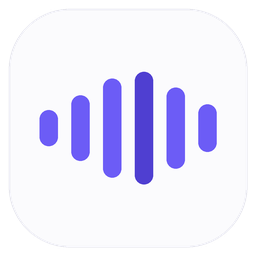
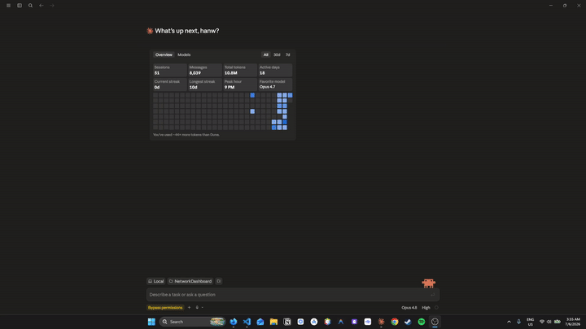
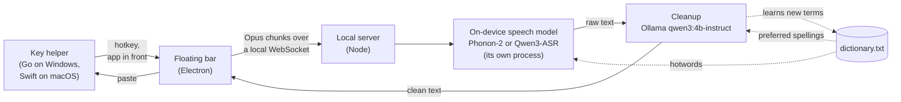

<div align="center">



# WhisprFlow

[](https://www.electronjs.org)
[](https://huggingface.co/FermionResearch/Phonon-2)
[](https://ollama.com)


[](LICENSE)

</div>

A local-first, open-source take on [Wispr Flow](https://wisprflow.ai) for Windows and macOS. Tap a hotkey, speak, tap again, and
clean, punctuated text is pasted into whatever you're typing in. By default everything runs on your computer: no account, no
subscription, and no audio leaves the machine.



## What it does

1. **Tap Right Alt** (Right Option on a Mac). A small bar appears at the bottom of the screen with a live wave that follows your voice.
2. **Speak, then tap Right Alt again.** Your speech is transcribed on your computer by Phonon-2.
3. **A local language model cleans it up.** Ollama running `qwen3:4b-instruct` removes "um" and "uh", fixes punctuation and grammar,
   applies your self-corrections ("at 2, actually make it 3" becomes "at 3"), turns spoken lists into lists, and lightly matches the
   tone of the app you're in (contractions in chat, a little more formal in email). It never answers your questions or follows
   instructions you dictate: it only edits.
4. **The text is pasted** into the active window. Your clipboard is restored afterwards, images and files included.

Holding the hotkey for more than 0.6 s, pressing Esc, or clicking the X cancels.

It also **learns your vocabulary**. After each dictation, names and jargon you said (Kubernetes, PostgreSQL, your colleagues' names)
are added to a dictionary that you can edit in Settings. Those terms steer both the speech model and the cleanup, so a misheard
"postgress" or "oh llama" comes out as PostgreSQL or Ollama.

## Three ways to recognize speech

| Mode | How it works | Leaves your computer |
|---|---|---|
| **Transcribe + Polish** (default) | On-device speech model, then a text model polishes it: Ollama by default, or any OpenAI-compatible service (LM Studio, vLLM, OpenRouter, ...) | Nothing, with Ollama |
| **Data Privacy** | On-device speech model only, no polishing | Nothing |
| **Native** | The recording goes straight to an audio model: Gemini 3.6 Flash or OpenAI's audio models, with your own API key | The recording |

On-device speech models:

| Model | Languages | Runs on | Size on disk |
|---|---|---|---|
| **Phonon-2 0.6B** (default) | English | CPU (Windows); Apple GPU via MLX on macOS (untested) | about 1.0 GB |
| Qwen3-ASR 0.6B | Many, strongest on Chinese and mixed Chinese and English | GPU (Vulkan on Windows, Metal on macOS) or CPU | 850 MB |

The main window has a model page with recommended setups, download progress, and benchmark numbers, plus a home page with your
words dictated, time saved, and an activity map. History keeps every dictation with its recording, and you can see what each
cloud call cost if you use one.

## How it compares to Wispr Flow

| | WhisprFlow | Wispr Flow |
|---|---|---|
| **Price** | Free | Subscription |
| **Where it runs** | Your computer by default; cloud models optional | Cloud |
| **Audio leaves your machine** | Not by default | Uploaded for processing |
| **Works offline** | Yes, in Transcribe + Polish (with Ollama) and Data Privacy | No |
| **End of speech to pasted text** | About 1.7 s for an 11 s dictation (measured below) | Sub-second (cloud) |
| **Adaptive dictionary** | Yes, learned and stored locally | Yes |
| **Customizable** | Fully: it's MIT-licensed code | No |

Measured on a laptop with an Intel i5-13500HX and an RTX 4050 (6 GB), Windows 11, for an 11-second dictation: 0.57 s to transcribe on
the CPU with Phonon-2 and 0.86 s for Ollama to polish it on the GPU, plus about 0.3 s to decode the recording. A cloud service on
datacenter GPUs is faster end to end; what you get back is no cost per word, no data leaving the machine, and full control.

## Architecture



- **App:** Electron 44 with plain ES modules, no UI framework. The floating bar, the main window, and onboarding are separate pages.
  The same code also runs as a `whisprflow` command-line tool.
- **Key helper:** a small native program (Go on Windows, Swift on macOS) that watches the global hotkey, names the app in front (for
  the tone of the cleanup), and pastes through the clipboard, restoring what was there.
- **Local server:** receives the recording as Opus chunks while you speak, then runs the chosen mode. Every step is logged with its
  timing, and cloud calls with their token counts and cost.
- **Phonon-2:** runs in Python with Fermion Research's `fermion-research` runtime, which the app installs into the model's own folder
  on first download with [uv](https://github.com/astral-sh/uv). Python 3.12 and every package are pinned, so every install gets the
  same versions. The app starts fermion's local server on a random port with a random key, and the server exits with the app, even
  if the app is killed.
- **Qwen3-ASR:** runs in-process through [transcribe.cpp](https://github.com/handy-computer/transcribe.cpp) (GPU) or
  [sherpa-onnx](https://github.com/k2-fsa/sherpa-onnx) (CPU).
- **Cleanup:** an OpenAI-compatible chat call. With Ollama the model is warmed up at startup, so the first dictation isn't slow.

## Decisions and trade-offs

**Phonon-2 as the default.** It is an English speech model built on NVIDIA's Parakeet TDT 0.6B v3, and on a mid-range laptop CPU it
transcribes 10 seconds of speech in about 0.4 s. That leaves the GPU free for the cleanup model. Qwen3-ASR stays available for other
languages.

**Hotwords help a little; the spelling list does the real work.** Phonon-2 accepts up to 25 hotwords per request, and the app sends
your 25 newest dictionary terms. Measured on a test clip, hotwords at the default strength barely changed the output, and turning them
up far enough to matter made the model invent words. So the whole dictionary also goes into the cleanup prompt, phrased so that a word
that sounds like one of your terms is written as listed. On the same clip that fixed "postgress" to PostgreSQL and "Supa Base" to
Supabase without touching ordinary words like "hero" or "base".

**Cleanup model: three candidates tested.**

| Model | Result |
|---|---|
| `llama3.2:3b` | Fast, but turned questions into commands ("can you send the file" became "Send the file"). |
| `qwen3:4b` (thinking) | Accurate, but "thought" for over a minute per sentence. Unusable for dictation. |
| **`qwen3:4b-instruct`** | Same accuracy, under a second when warm. This is the default. |

**"It answers my questions."** Sent as a plain chat message, a dictated question like "what's the weather in Singapore" got answered
instead of cleaned up. The transcript is now wrapped in `<transcript>` tags, the prompt says it is text to edit, and two examples, sent
as earlier turns of the conversation, show a question and a request passing through unanswered. Sending the examples as chat turns
rather than inside the prompt also fixed transcripts that came back unpunctuated.

**Verbatim beats rewriting.** Letting the model rephrase for tone sometimes returned a different sentence than the one spoken, and once
silently dropped a whole clause. The prompt is deliberately strict: keep the speaker's words, only remove fillers, fix grammar, and
apply explicit self-corrections. Tone is limited to contractions and punctuation.

**Cleanup failures never lose a dictation.** If Ollama isn't running or times out, what was heard is pasted as is, with a note on the
bar saying cleanup was skipped.

**A Windows deadlock.** The first version of the Phonon-2 launcher watched its own stdin to exit with the app. On Windows, a thread
blocked reading a pipe made the model load hang forever. The launcher now waits on its parent process instead.

**Design.** The interface follows Apple's guidance for fluid interfaces: things that move use a critically damped spring, every
control responds the moment it's pressed, type tracking changes with size, and the windows respect reduce motion, reduce
transparency, and more contrast. The bar's wave is drawn like Siri's: a main curve with mirrored echoes in a bell-shaped envelope.

## Install

### Windows

Download **WhisprFlow-Setup-x64.exe** from the [latest release](https://github.com/zghanw/whisprflow/releases/latest) and run it. Or,
in PowerShell:

```powershell
irm https://github.com/zghanw/whisprflow/releases/latest/download/install.ps1 | iex
```

It installs into `%USERPROFILE%\.whisprflow` without administrator rights, adds a Start menu entry and the `whisprflow` command, then
opens onboarding. Onboarding downloads Phonon-2 (about 400 MB, 1 GB on disk) and, if [Ollama](https://ollama.com) is installed, pulls
`qwen3:4b-instruct` (2.5 GB). Install Ollama first for the default setup; without it, dictation works and pastes the raw transcript.

Requirements: Windows 10 1809 or later, x64. The default setup runs on the CPU; Ollama uses the GPU when there is one.

### macOS (untested)

The macOS code paths (Swift key helper, Metal and MLX models, the app bundle) are kept and should work, but no Mac was available to
test this release, and no macOS package is published yet. Build from source (below) on Apple silicon if you want to try it.

### From source

```bash
git clone https://github.com/zghanw/whisprflow.git
cd whisprflow
npm ci
npm run build:native
npm start
```

Needs Node 22.13 or later, and Go 1.27 (Windows) or the Xcode command-line tools (macOS). `npm run test:unit` runs the tests, `npm run lint` the
linter, and `npm run release` builds the Windows release into `dist/release`.

## Using it

The main window has everything: modes and models, keys for cloud services, the dictionary, themes, history, and settings. The same
things are available from a terminal:

| Command | What it does |
|---|---|
| `whisprflow` | Start (or show status if running) |
| `whisprflow mode local` / `private` / `native` | Switch the recognition mode |
| `whisprflow transcriber` | List, download, check, or delete on-device speech models |
| `whisprflow polish` | Choose the cleanup model |
| `whisprflow theme` | Violet (default), Ink, Cinnabar, or Indigo |
| `whisprflow update` | Update to the latest release; settings and history stay |
| `whisprflow uninstall` | Remove the app, optionally keeping your data |

## Known limitations

- **Phonon-2 is English only.** Switch to Qwen3-ASR for other languages.
- **macOS is untested** (see above). Windows on ARM and Intel Macs get Qwen3-ASR as the default; Phonon-2 needs Windows x64 or Apple
  silicon.
- **Phonon-2 runs on the CPU on Windows.** There is no native GPU path for it there; it is fast enough on a modern CPU.
- **Ollama is a separate install.** Onboarding detects it and pulls the model, but can't install it for you.
- **Pasting uses the clipboard.** It's instant and keeps line breaks; the clipboard is restored afterwards. In a terminal, text goes
  in only where the terminal accepts a paste.
- **The hotkey can't be seen while a window running as administrator is in front**, unless WhisprFlow also runs as administrator.

## Credits

- **Phonon-2** by [Fermion Research](https://huggingface.co/FermionResearch/Phonon-2), licensed under
  [CC BY 4.0](https://creativecommons.org/licenses/by/4.0/), built on
  [Parakeet TDT 0.6B v3](https://huggingface.co/nvidia/parakeet-tdt-0.6b-v3) by NVIDIA (CC BY 4.0). The `fermion-research` runtime is
  Apache 2.0.
- **[Qwen3-ASR](https://huggingface.co/Qwen/Qwen3-ASR-0.6B)** by the Qwen team at Alibaba Cloud (Apache 2.0).
- **[Ollama](https://ollama.com)** and **[Qwen3](https://huggingface.co/Qwen)** for local cleanup.
- **[Electron](https://www.electronjs.org)**, **[transcribe.cpp](https://github.com/handy-computer/transcribe.cpp)**,
  **[sherpa-onnx](https://github.com/k2-fsa/sherpa-onnx)**, and **[uv](https://github.com/astral-sh/uv)**.
- The Siri-style wave adapts the math from [qreenify/unknown-pleasures](https://github.com/qreenify/unknown-pleasures).
- Product idea and two-stage pipeline inspired by the publicly documented approach of [Wispr Flow](https://wisprflow.ai).

Third-party licenses are listed in [THIRD_PARTY_NOTICES.md](THIRD_PARTY_NOTICES.md).

## License

[MIT](LICENSE).
