<p align="center">
  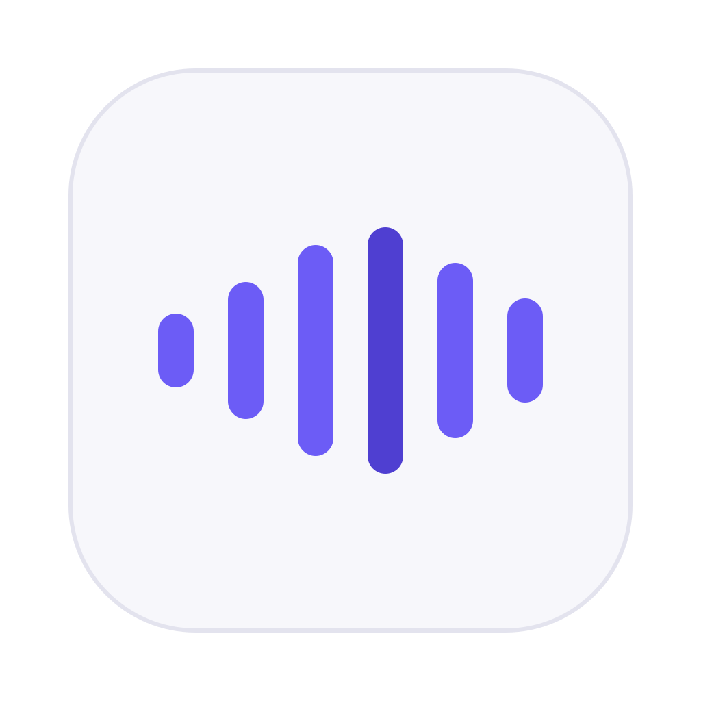
</p>

<h1 align="center">WhisprFlow</h1>

<p align="center">
  <b>Speak, don't type.</b><br>
  Voice dictation for Windows and macOS that runs on your own computer.<br>
  Tap a key, talk, tap again, and clean text lands wherever you're typing.
</p>

<p align="center">
  
  
  
  <a href="LICENSE"></a>
</p>

<p align="center">
  
</p>

<picture>
  <source media="(prefers-color-scheme: dark)" srcset="docs/screenshots/home-dark.png" />
  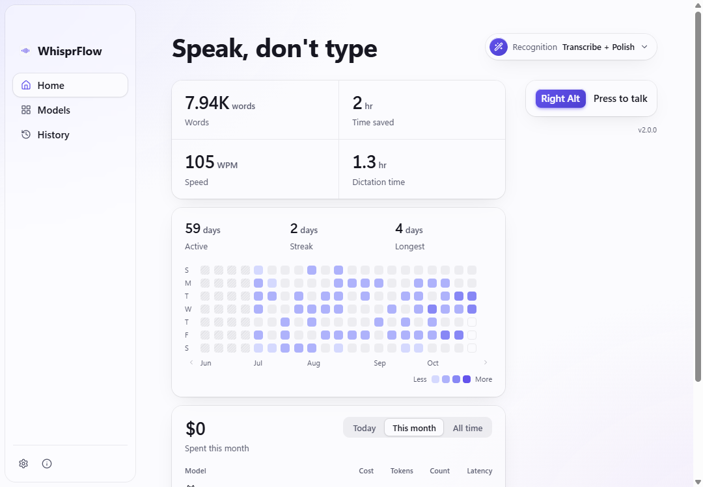
</picture>

<p align="center"><sub>Screenshots from the Windows app, with sample history.</sub></p>

- Tap **Right Alt** (Right Option on a Mac) to start, speak, and tap it again: the text is pasted at your cursor.
- Fillers, false starts, and self-corrections are cleaned up; punctuation is added; spoken lists become lists.
- By default nothing leaves your computer: Phonon-2 transcribes on the device and Ollama polishes on the device. No account, no
  subscription.

## What happens to your words

Real output from the default setup (Phonon-2, then Ollama `qwen3:4b-instruct`), on synthesized speech:

| You say | WhisprFlow types |
|---|---|
| um so can you send me the slides from yesterday's review when you get a chance | So can you send me the slides from yesterday's review when you get a chance? |
| let's meet tomorrow at nine, no wait, nine thirty, and bring last week's numbers | Let's meet tomorrow at nine thirty and bring last week's numbers. |
| ok so first we need to update the docs, second fix the login bug, and third ship the release | - Update the docs<br>- Fix the login bug<br>- Ship the release |
| uh we moved the database to postgres and the API now runs on kubernetes | We moved the database to PostgreSQL and the API now runs on Kubernetes. |

In the last one the speech model heard "KavirNets". Kubernetes and PostgreSQL were in the dictionary, so the cleanup wrote them as
listed. WhisprFlow learns those terms from your own dictations.

The cleanup only edits: it never answers a question you dictate or follows an instruction in it, and it doesn't reword what you said.
It lightly matches the app you're in, with contractions in chat and a little more formality in email.

## Install

<p align="center">
  <a href="https://github.com/zghanw/whisprflow/releases/latest/download/WhisprFlow-Setup-x64.exe"></a>
  <a href="https://github.com/zghanw/whisprflow/releases/latest"></a>
</p>

Run **WhisprFlow-Setup-x64.exe**, or install from PowerShell:

```powershell
irm https://github.com/zghanw/whisprflow/releases/latest/download/install.ps1 | iex
```

Either way it installs into `%USERPROFILE%\.whisprflow` without administrator rights, adds a Start menu entry and the `whisprflow`
command, and opens setup. `whisprflow uninstall` removes everything again.

For the default setup, install [Ollama](https://ollama.com) first. Setup then downloads Phonon-2 (about 400 MB, 1 GB on disk) and
pulls `qwen3:4b-instruct` (2.5 GB). Without Ollama, dictation still works and pastes what was heard. Requires Windows 10 1809 or
later on x64.

**macOS:** the code paths are kept (Swift key helper, Metal and MLX models, app bundle) but untested, and no macOS package is
published yet. On Apple silicon you can build from source.

<details>
<summary><b>Build from source</b></summary>

```bash
git clone https://github.com/zghanw/whisprflow.git
cd whisprflow
npm ci
npm run build:native
npm start
```

Needs Node 22.13 or later, and Go 1.27 (Windows) or the Xcode command-line tools (macOS). `npm run test:unit` runs the tests,
`npm run lint` the linter, `npm run release` builds the Windows release into `dist/release`, and `node scripts/dev/screens.mjs`
captures the app's windows (its header lists the options behind these screenshots).

</details>

## Setup in a minute

Setup walks through each step once, and checks it works before moving on.

<table>
  <tr>
    <td width="50%"><picture><source media="(prefers-color-scheme: dark)" srcset="docs/screenshots/onboarding-mode-dark.png" />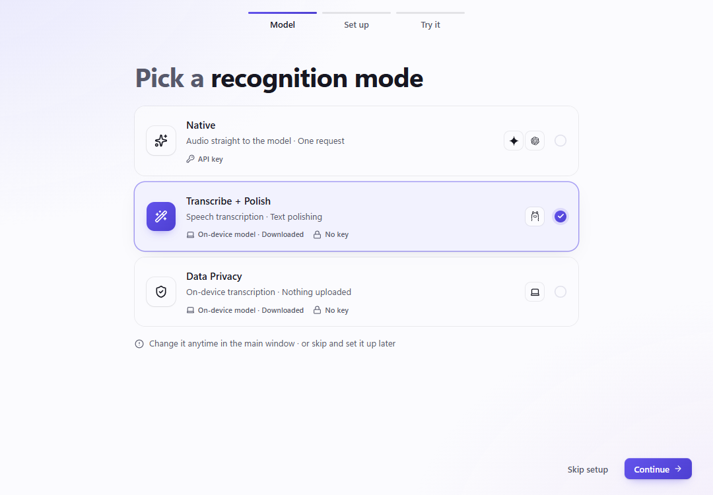</picture></td>
    <td width="50%"><picture><source media="(prefers-color-scheme: dark)" srcset="docs/screenshots/onboarding-prepare-dark.png" />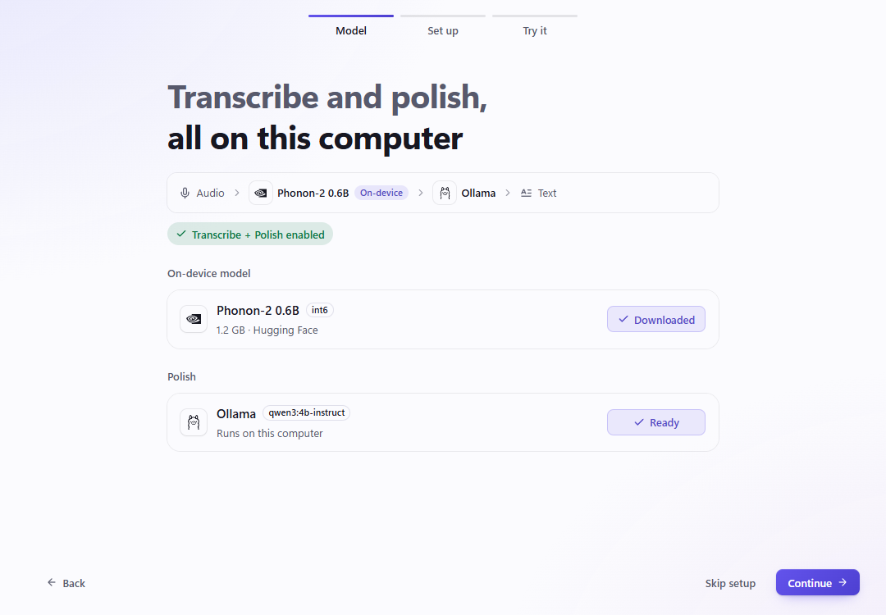</picture></td>
  </tr>
  <tr>
    <td align="center"><sub><b>1</b> Pick how speech becomes text</sub></td>
    <td align="center"><sub><b>2</b> Download the models</sub></td>
  </tr>
  <tr>
    <td><picture><source media="(prefers-color-scheme: dark)" srcset="docs/screenshots/onboarding-permissions-dark.png" />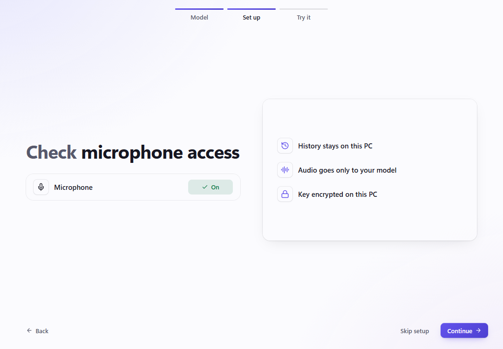</picture></td>
    <td><picture><source media="(prefers-color-scheme: dark)" srcset="docs/screenshots/onboarding-microphone-dark.png" />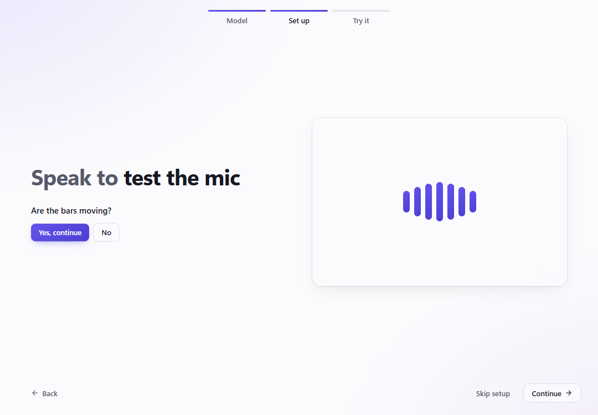</picture></td>
  </tr>
  <tr>
    <td align="center"><sub><b>3</b> Allow the microphone</sub></td>
    <td align="center"><sub><b>4</b> Test it</sub></td>
  </tr>
  <tr>
    <td><picture><source media="(prefers-color-scheme: dark)" srcset="docs/screenshots/onboarding-hotkey-dark.png" />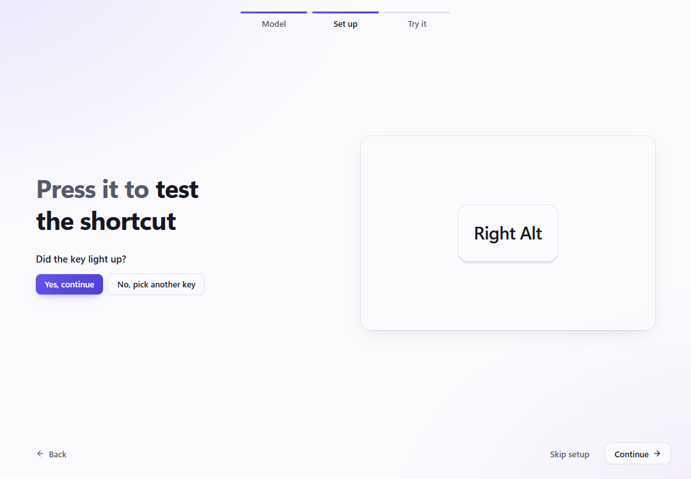</picture></td>
    <td><picture><source media="(prefers-color-scheme: dark)" srcset="docs/screenshots/onboarding-done-dark.png" />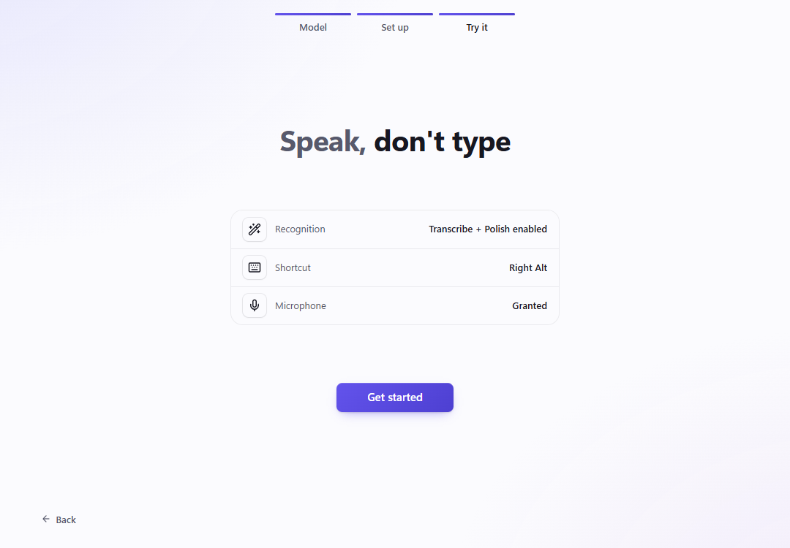</picture></td>
  </tr>
  <tr>
    <td align="center"><sub><b>5</b> Try the shortcut</sub></td>
    <td align="center"><sub><b>6</b> Done: speak, don't type</sub></td>
  </tr>
</table>

## Three ways to listen

<picture>
  <source media="(prefers-color-scheme: dark)" srcset="docs/screenshots/modes-dark.png" />
  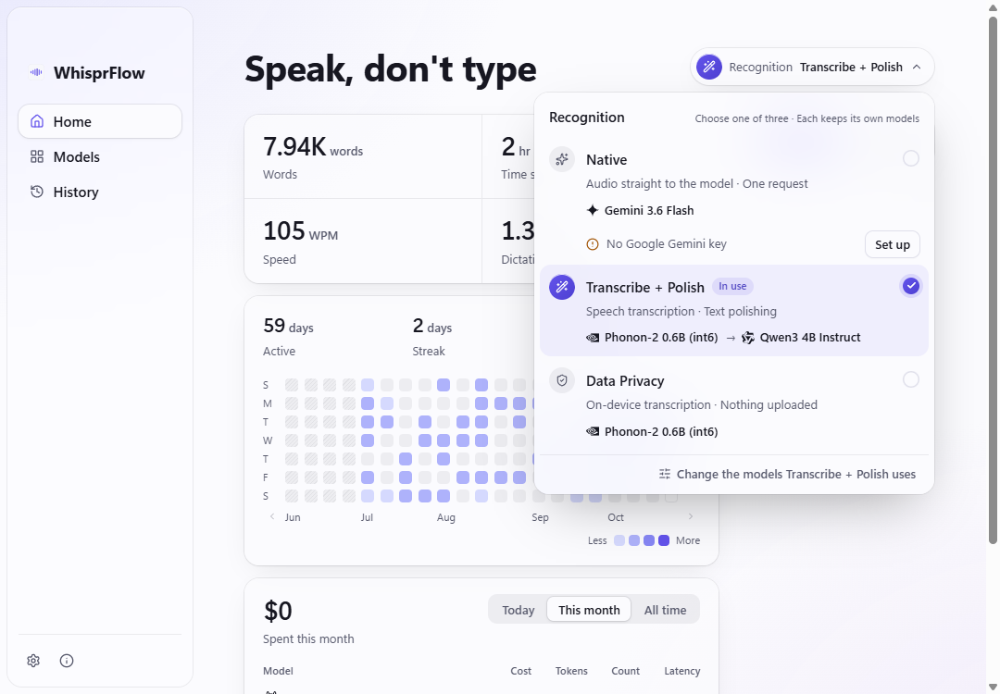
</picture>

| Mode | How it works | Leaves your computer |
|---|---|---|
| **Transcribe + Polish** (default) | An on-device speech model, then a text model polishes it: Ollama by default, or any OpenAI-compatible service (LM Studio, vLLM, OpenRouter, ...) | Nothing, with Ollama |
| **Data Privacy** | The on-device speech model only, no polishing | Nothing |
| **Native** | The recording goes straight to an audio model: Gemini 3.6 Flash or OpenAI's audio models, with your own API key | The recording |

Switching is one click, and each mode keeps its own models, so switching back restores what you had.

## Models

<table>
  <tr>
    <td width="50%"><picture><source media="(prefers-color-scheme: dark)" srcset="docs/screenshots/models-dark.png" />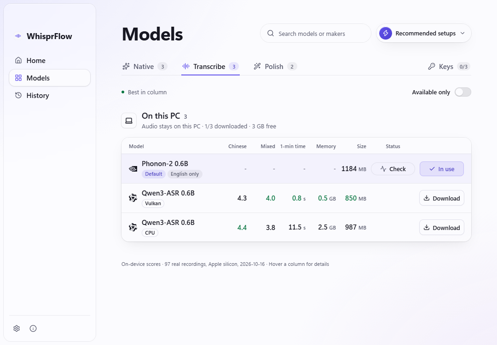</picture></td>
    <td width="50%"><picture><source media="(prefers-color-scheme: dark)" srcset="docs/screenshots/presets-dark.png" />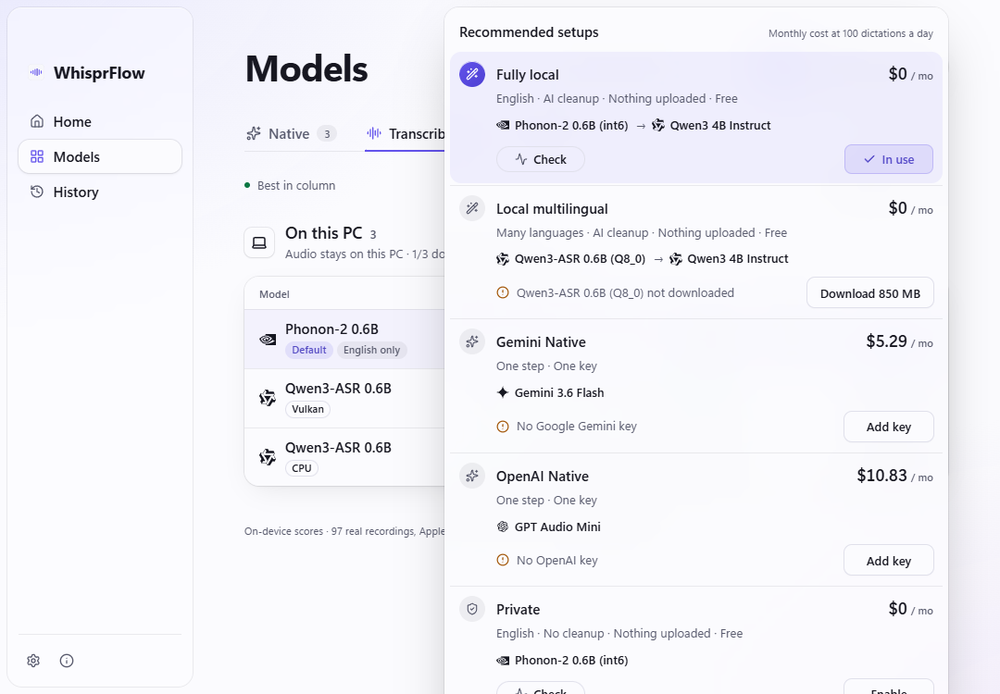</picture></td>
  </tr>
  <tr>
    <td align="center"><sub>On-device models, downloaded in the background</sub></td>
    <td align="center"><sub>Recommended setups, with what each costs a month</sub></td>
  </tr>
</table>

| On-device model | Languages | Runs on | On disk |
|---|---|---|---|
| **Phonon-2 0.6B** (default) | English | CPU on Windows; Apple GPU via MLX on macOS (untested) | about 1.0 GB |
| Qwen3-ASR 0.6B | Many; strongest on Chinese and mixed Chinese and English | GPU (Vulkan on Windows, Metal on macOS) or CPU | 850 MB |

Cloud models are optional: bring a Gemini or OpenAI key, or point the cleanup at any OpenAI-compatible service. Keys are encrypted
on your computer, and every cloud call is logged with its tokens and cost.

## History and your dictionary

<table>
  <tr>
    <td width="50%"><picture><source media="(prefers-color-scheme: dark)" srcset="docs/screenshots/history-dark.png" />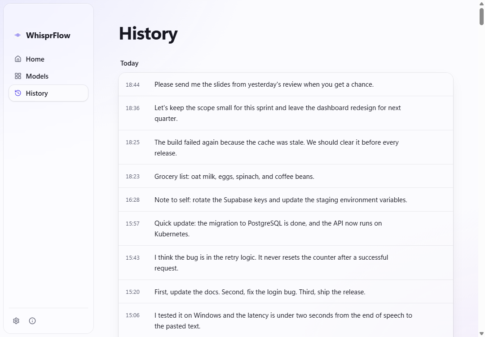</picture></td>
    <td width="50%"><picture><source media="(prefers-color-scheme: dark)" srcset="docs/screenshots/dictionary-dark.png" />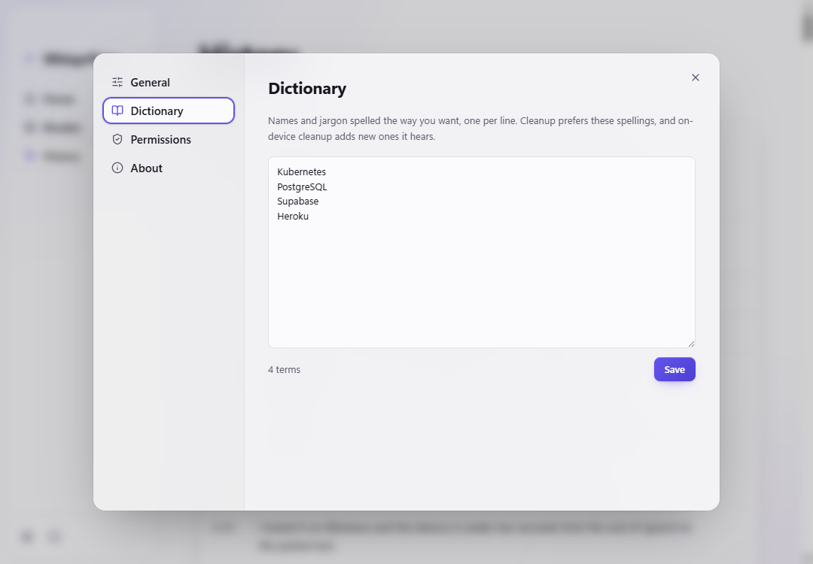</picture></td>
  </tr>
  <tr>
    <td align="center"><sub>Every dictation, with its recording</sub></td>
    <td align="center"><sub>Names and jargon, learned and editable</sub></td>
  </tr>
</table>

After each dictation, names and jargon you said are added to your dictionary. Edit it any time in Settings; it steers both the
speech model and the cleanup.

## How it compares to Wispr Flow

| | WhisprFlow | Wispr Flow |
|---|---|---|
| **Price** | Free | Subscription |
| **Where it runs** | Your computer by default; cloud models optional | Cloud |
| **Audio leaves your machine** | Not by default | Uploaded for processing |
| **Works offline** | Yes, in Transcribe + Polish (with Ollama) and Data Privacy | No |
| **End of speech to pasted text** | About 1.7 s for an 11 s dictation (measured below) | Sub-second (cloud) |
| **Adaptive dictionary** | Yes, learned and stored locally | Yes |
| **Customizable** | Fully: MIT-licensed code | No |

Measured on a laptop with an Intel i5-13500HX and an RTX 4050 (6 GB), Windows 11, for an 11-second dictation: 0.57 s to transcribe
on the CPU with Phonon-2 and 0.86 s for Ollama to polish it on the GPU, plus about 0.3 s to decode the recording. A cloud service on
datacenter GPUs is faster end to end; what you get back is no cost per word, nothing leaving the machine, and full control.

## Under the hood

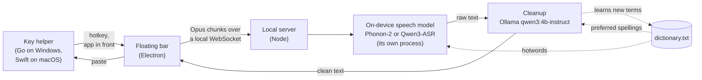

- **App:** Electron 44 with plain ES modules and no UI framework. The bar, the main window, and setup are separate pages; the same
  code also runs as the `whisprflow` command.
- **Key helper:** a small native program that watches the global hotkey, names the app in front (for the tone of the cleanup), and
  pastes through the clipboard, then restores what was there, images and files included.
- **Local server:** receives the recording as Opus chunks while you speak, then runs the chosen mode. Each step is logged with its
  timing, and cloud calls with their tokens and cost.
- **Phonon-2:** runs in Python with Fermion Research's `fermion-research` runtime, which the app installs into the model's own folder
  with [uv](https://github.com/astral-sh/uv) on first download. Python 3.12 and every package are pinned, so every install gets the
  same versions. The app starts fermion's server on a random local port with a random key, and the server exits with the app, even if
  the app is killed.
- **Qwen3-ASR:** runs in-process through [transcribe.cpp](https://github.com/handy-computer/transcribe.cpp) (GPU) or
  [sherpa-onnx](https://github.com/k2-fsa/sherpa-onnx) (CPU).
- **Design:** motion uses a critically damped spring, every control answers the moment it's pressed, type tracking changes with
  size, and the windows follow reduce motion, reduce transparency, and more contrast. The bar's wave is drawn the way Siri's is: a
  main curve with mirrored echoes in a bell-shaped envelope.

## Decisions and trade-offs

**Phonon-2 as the default.** An English speech model built on NVIDIA's Parakeet TDT 0.6B v3 that transcribes 10 seconds of speech in
about 0.4 s on a mid-range laptop CPU, leaving the GPU to the cleanup model. Qwen3-ASR stays available for other languages.

**Hotwords help a little; the spelling list does the real work.** Phonon-2 takes up to 25 hotwords per request, and the app sends
your 25 newest dictionary terms. On a test clip, hotwords at the default strength barely changed the output, and turning them up far
enough to matter made the model invent words. So the whole dictionary also goes into the cleanup prompt, phrased so that a word that
sounds like one of your terms is written as listed. That fixes misheard terms without touching ordinary words that merely sound
similar.

**Cleanup model: three candidates tested.**

| Model | Result |
|---|---|
| `llama3.2:3b` | Fast, but turned questions into commands ("can you send the file" became "Send the file"). |
| `qwen3:4b` (thinking) | Accurate, but "thought" for over a minute per sentence. Unusable for dictation. |
| **`qwen3:4b-instruct`** | Same accuracy, under a second when warm. This is the default. |

**"It answers my questions."** Sent as a plain chat message, a dictated question got answered instead of cleaned up. The transcript
now goes inside `<transcript>` tags, the prompt says it is text to edit, and two examples, sent as earlier turns of the conversation,
show a question and a request passing through unanswered.

**Verbatim beats rewriting.** Letting the model rephrase for tone sometimes returned a different sentence than the one spoken, and
once silently dropped a whole clause. The prompt keeps the speaker's words and only removes fillers, fixes grammar, and applies
explicit self-corrections.

**Cleanup failures never lose a dictation.** If Ollama isn't running or times out, what was heard is pasted as is, with a note on
the bar saying cleanup was skipped.

## Commands

The main window covers everything; the same is available from a terminal:

| Command | What it does |
|---|---|
| `whisprflow` | Start, or show status if it's running |
| `whisprflow mode local` / `private` / `native` | Switch the recognition mode |
| `whisprflow transcriber` | List, download, check, or delete on-device speech models |
| `whisprflow polish` | Choose the cleanup model |
| `whisprflow theme` | Violet (default), Ink, Cinnabar, or Indigo |
| `whisprflow update` | Update to the latest release; settings and history stay |
| `whisprflow uninstall` | Remove the app, optionally keeping your data |

## Known limitations

- **Phonon-2 is English only.** Switch to Qwen3-ASR for other languages.
- **macOS is untested.** Windows on ARM and Intel Macs get Qwen3-ASR as the default; Phonon-2 needs Windows x64 or Apple silicon.
- **Phonon-2 runs on the CPU on Windows.** There is no native GPU path for it there; a modern CPU is fast enough.
- **Ollama is a separate install.** Setup detects it and pulls the model, but can't install it for you.
- **Pasting uses the clipboard.** It's instant and keeps line breaks, and the clipboard is restored afterwards. In a terminal, text
  goes in only where the terminal accepts a paste.
- **The hotkey can't be seen while a window running as administrator is in front**, unless WhisprFlow also runs as administrator.

## Credits

- **Phonon-2** by [Fermion Research](https://huggingface.co/FermionResearch/Phonon-2), licensed under
  [CC BY 4.0](https://creativecommons.org/licenses/by/4.0/), built on
  [Parakeet TDT 0.6B v3](https://huggingface.co/nvidia/parakeet-tdt-0.6b-v3) by NVIDIA (CC BY 4.0). The `fermion-research` runtime
  is Apache 2.0.
- **[Qwen3-ASR](https://huggingface.co/Qwen/Qwen3-ASR-0.6B)** by the Qwen team at Alibaba Cloud (Apache 2.0).
- **[Ollama](https://ollama.com)** and **[Qwen3](https://huggingface.co/Qwen)** for local cleanup.
- **[Electron](https://www.electronjs.org)**, **[transcribe.cpp](https://github.com/handy-computer/transcribe.cpp)**,
  **[sherpa-onnx](https://github.com/k2-fsa/sherpa-onnx)**, and **[uv](https://github.com/astral-sh/uv)**.
- The Siri-style wave adapts the math from [qreenify/unknown-pleasures](https://github.com/qreenify/unknown-pleasures).
- The product idea and its two-stage pipeline are inspired by the publicly documented approach of [Wispr Flow](https://wisprflow.ai).

Third-party licenses are listed in [THIRD_PARTY_NOTICES.md](THIRD_PARTY_NOTICES.md).

## License

[MIT](LICENSE).
